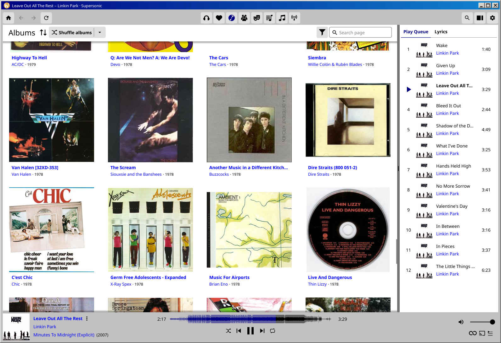

# supersonic-theme-win98

A Windows 98 theme for [Supersonic](https://github.com/supersonic-app/supersonic).

- **Light:** the classic "Windows Standard" colors - silver grey bars, white pages, navy highlights and blue links.
- **Dark:** Windows 98 had no dark mode, so this one is made from its 16-color palette - black pages, navy bars, teal buttons and cyan links.

## Install

Put `win98.toml` in Supersonic's themes folder:

- Linux: `~/.config/supersonic/themes`
- Linux (Flatpak): `~/.var/app/io.github.dweymouth.supersonic/config/supersonic/themes`
- Windows: `C:\Users\<yourname>\AppData\Roaming\supersonic\themes`
- macOS: `~/Library/Application Support/supersonic/themes`

Then restart Supersonic and pick **Windows 98** in Settings.
